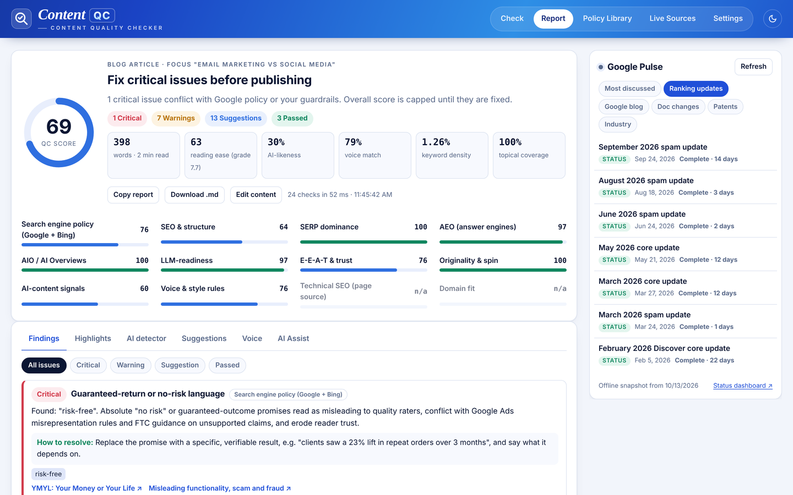
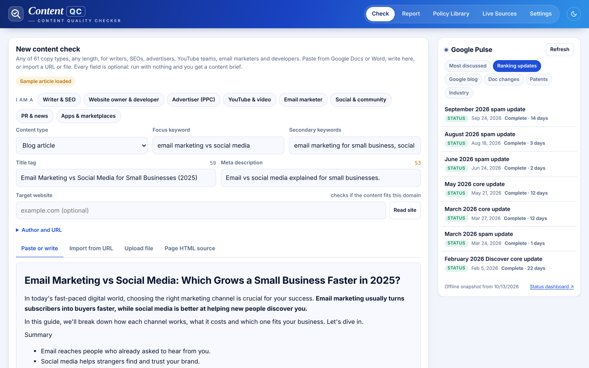
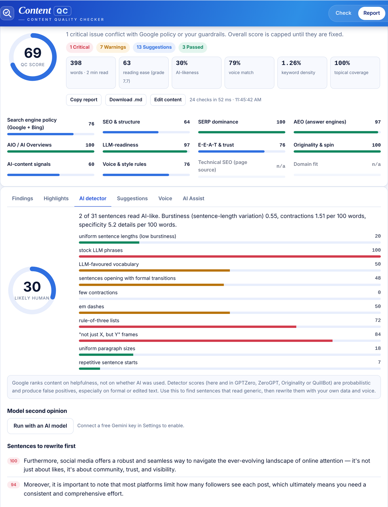
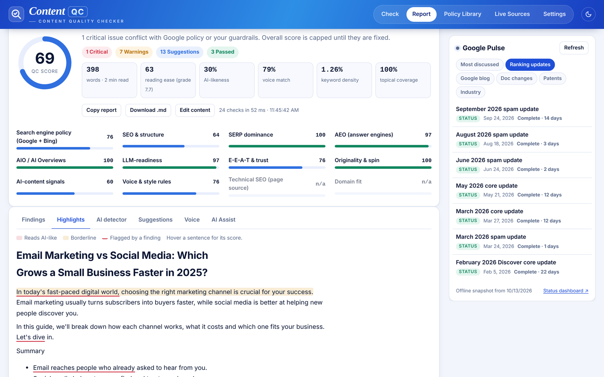
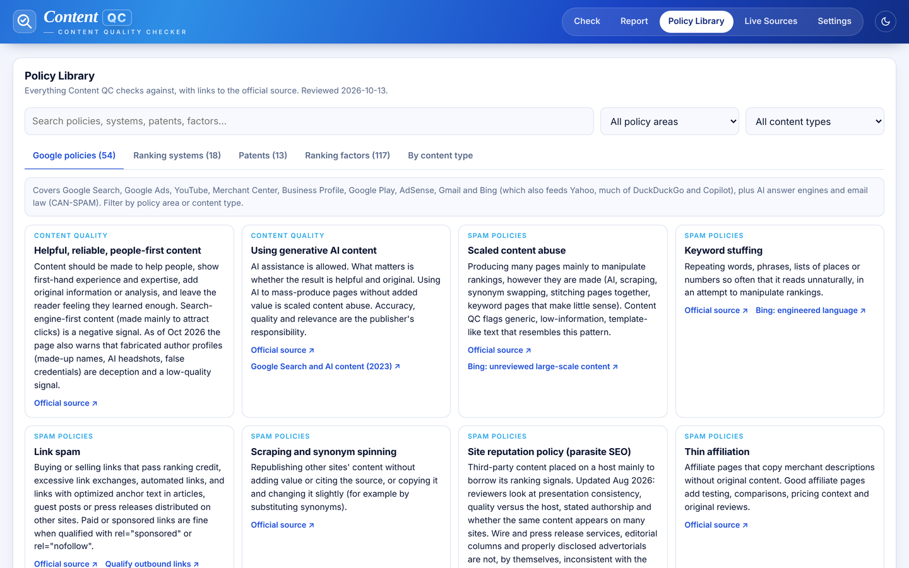
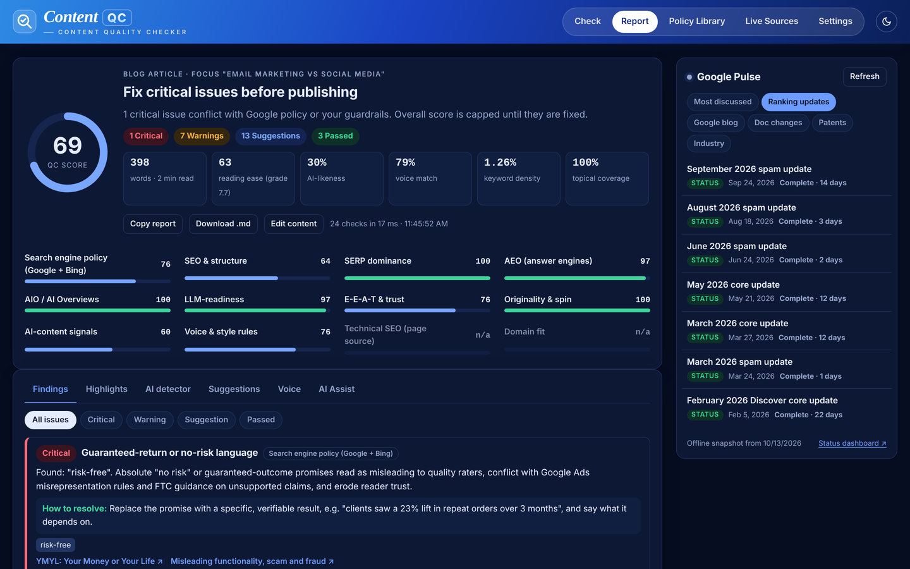
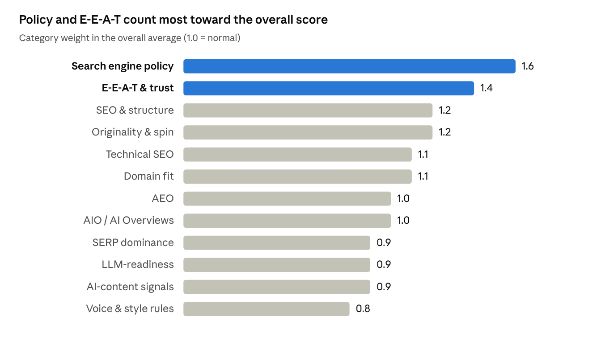
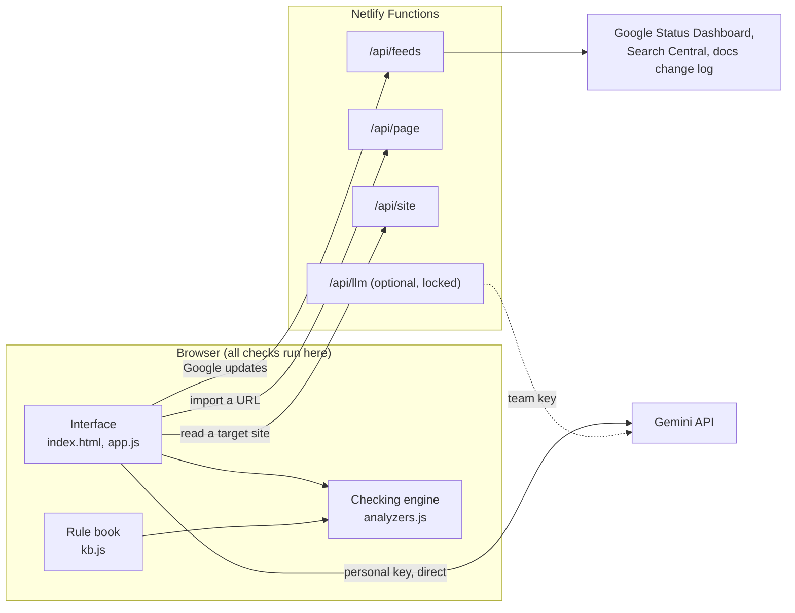

<div align="center">

# Content QC

**Content quality checker for writers, SEOs and marketers**

Checks any piece of copy against Google's published policies, ranking systems and patents, explains every conflict, suggests a fix and links to the official source.

[**Live demo**](https://content-qc.netlify.app) · [How it works](docs/HOW-IT-WORKS.md) · [Copyright](#copyright)

   



</div>

## Why I built it

I write SEO content, market news, press releases and landing pages for finance and trading brands, a YMYL niche where Google holds content to its strictest standards. Checking every draft by hand against spam policies, helpful content guidance, E-E-A-T and AI-content signals took longer than writing it.

Content QC does that review in under a second. It is free to run, it works for any kind of copy, and the content you check never leaves your browser.

## Highlights

- **61 content types, 11 families:** blog articles, reviews, guest posts, news, press releases, landing pages, emails, Search and social ads, YouTube, Merchant Center, Google Play and more. Each type gets its own word range, platform limits and scoring rules.
- **12 scored categories:** search engine policy, SEO and structure, SERP features, AEO, AI Overviews, LLM-readiness, E-E-A-T, originality, AI-content signals, voice and style rules, technical SEO and domain fit.
- **Explainable findings:** every finding states what was matched, why it conflicts, how to fix it and which official page says so.
- **A local AI-content detector:** 10 signals modelled on GPTZero and ZeroGPT, per-sentence highlighting and an optional Gemini second opinion.
- **Domain fit:** reads a target website's sitemap and feed to score topical fit, spot keyword cannibalization and suggest internal links with real URLs.
- **Always current:** watches Google's Status Dashboard, Search Central blog and documentation change log every 30 minutes and flags any change to a rule the app relies on.

## Screenshots

**Check page.** Pick a role and content type, add keywords and an optional target website, then paste, import a URL or upload a file.



**AI detector.** Ten weighted signals, the sentences to rewrite first and the AI-associated phrases found.



**Highlights and Policy Library.** Sentence-level highlighting in the text, and the full rule book with official links.





**Dark mode.** Follows the system setting, or switch it from the header.



## What it checks

The full list of parameters and thresholds is in [How it works](docs/HOW-IT-WORKS.md). In short:

- **Policy (Google, Bing, Ads, YouTube, Merchant Center, Gmail, FTC):** keyword stuffing, link spam and unqualified paid links, hidden text, guaranteed-return and clickbait claims, restricted claims, prompt injection aimed at AI systems, missing sponsorship disclosure, platform character limits.
- **SEO, SERP and answer engines:** heading structure, keyword placement and density, title and meta length, links and anchors, image alt text, semantic coverage, snippet-ready section openings, question headings, direct answers, People Also Ask coverage.
- **AI Overviews and LLM-readiness:** early definitions, attributable facts, readability (Flesch), long sentences, pronoun-led sections, passive voice, entity consistency.
- **E-E-A-T and originality:** first-hand experience, citations, unsourced statistics, unverified performance claims, risk statements, bylines, spun phrases, near-duplicate sentences, information gain.
- **Voice and style rules (on by default, switchable in Settings):** a 14-trait voice profile for clear, beginner-friendly expert writing, plus switchable rules for em dashes, list sizes, FAQ count, tables, paragraph length, press releases, a market news format and crypto-as-trading wording.
- **Technical SEO (from page HTML):** robots and snippet directives, canonical, viewport, JSON-LD validity, Open Graph, hreflang, image dimensions, crawlable links, ads on thin pages.

## How scoring works

Each category starts at 100 and loses 24 points per critical finding, 9 per warning and 3 per suggestion. The overall score is a weighted average of the categories that apply to the content type, so short copy is never penalised for lacking headings. Any critical policy finding caps the overall score at 69.



The AI detector combines 10 signals (sentence-length burstiness, stock LLM phrases, LLM-favoured vocabulary, formal transitions, contractions, em dashes, rule-of-three lists, "not just X, but Y" frames, paragraph uniformity and repeated openers), subtracts a credit for concrete human detail, and maps the result through a logistic curve:

```math
\text{AI-likeness} = \frac{100}{1 + e^{-9(\text{raw} - 0.42)}}
```

## Architecture



- **Front end:** vanilla HTML, CSS and JavaScript with no framework and no build step. Fonts from Google Fonts; one pinned library (mammoth.js) reads .docx files.
- **Back end:** four small Netlify Functions sharing `lib/core.mjs`. They only fetch public pages (feeds, a URL to import, a target site's sitemap) and never receive the content being checked. Feed and site responses are cached on Netlify's CDN to stay within the free plan.
- **Fallbacks:** if a function is unreachable the app uses public CORS proxies, then the last saved copy, then a built-in snapshot, so it keeps working on any static host.
- **AI (optional):** each user brings their own free Gemini key, or an OpenAI-compatible endpoint. A team proxy exists but stays locked unless both a key and an access code are set.

## Privacy and security

- The text you check is analysed in your browser and is not sent anywhere unless you run an AI Assist task.
- Nothing you type or paste is saved. The editor and fields start empty on every visit, with no sample, site or author pre-filled.
- A personal Gemini key goes straight from the browser to Google in a request header. It is never sent to the Netlify functions, is kept in tab storage by default and can be forgotten with one click.
- Strict headers on every response: Content-Security-Policy (scripts only from the site and one pinned CDN file), no referrer, no framing.
- The URL and site readers block private and local addresses and only read allow-listed or explicitly requested domains.

## Try it

Use the [live demo](https://content-qc.netlify.app). It runs on Netlify's free plan with the four functions above; the checks run in your browser, so nothing you paste is stored.

## Project structure

```
index.html              the app shell
assets/
  styles.css            design tokens, light and dark themes
  app.js                routing, pages, report rendering, settings
  analyzers.js          content model, all checks, scoring, AI detector
  kb.js                 rule book: policies, content types, ranking systems, patents, factors, phrase lists
  ai.js                 Gemini and OpenAI-compatible providers, AI Assist prompts
  feeds.js              Google Pulse and the rule-book watch
  site.js               target website reader (domain fit)
lib/core.mjs            shared server code: feeds, page and site readers, Gemini proxy
netlify/functions/      /api/feeds, /api/page, /api/site, /api/llm
netlify.toml            Netlify settings and security headers
server.js               local server with the same routes
docs/                   how-it-works guide, screenshots
```

## Keeping the rule book current

Every policy, ranking system, patent and phrase list lives in `assets/kb.js`, each with a link to its source. When the app's watch reports that Google changed a page it relies on, update the summary there and redeploy. The rule book was last reviewed on 13 October 2026.

## Limits

Content QC follows Google's published guidance; it cannot see search volume, backlinks, competitors or Google's live ranking signals, and it does not fact-check numbers. AI detection is a probability, like every detector. Findings are guidance, not a guarantee of rankings.

## Author

Ideated and developed by **Mansura Akter Susama**, technical writer and SEO executive.

Contact: [LinkedIn](https://www.linkedin.com/in/writersusama/)

## Copyright

Copyright © 2026 Mansura Akter Susama. All rights reserved.

This repository is public so the code can be viewed as part of my portfolio. It is not open source. You may not copy, modify, redistribute, host or use any part of it, in whole or in part, without my written permission. See [LICENSE](LICENSE). For permission or collaboration, contact me on [LinkedIn](https://www.linkedin.com/in/writersusama/).
