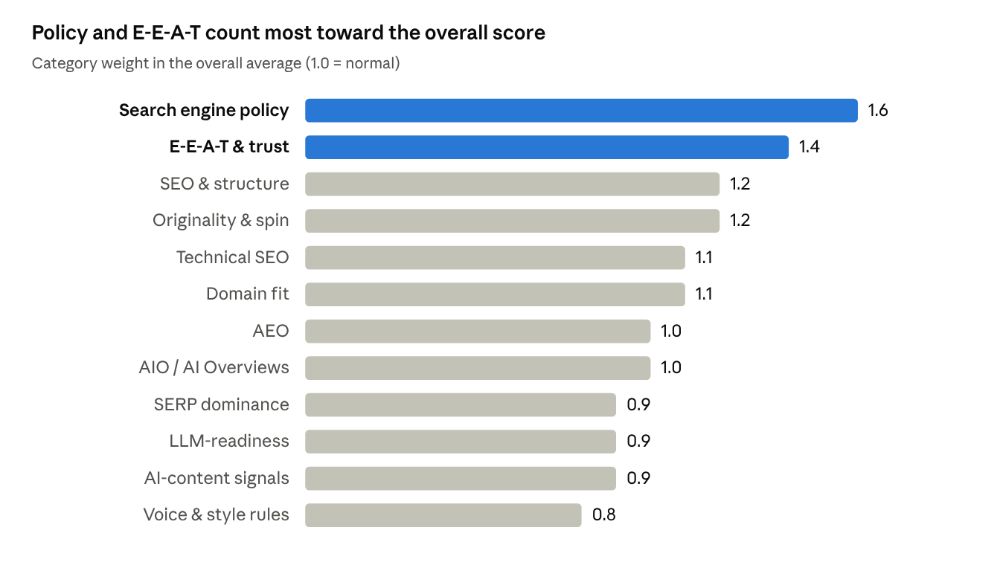

# Content QC: How It Works

Rule book last reviewed 13 Oct 2026. Back to the [README](../README.md).

## Overview

Content QC checks any piece of copy against Google's published policies and ranking guidance, then gives a score from 0 to 100, a list of findings and a fix for each. Every check runs inside the browser. Your text never leaves your computer unless you turn on AI Assist with your own Gemini key.

The app has four parts:

- **The interface** (`index.html`, `assets/styles.css`, `assets/app.js`): the five pages (Check, Report, Policy Library, Live Sources, Settings) and the Google Pulse panel.
- **The rule book** (`assets/kb.js`): 54 policies, 61 content types, 117 ranking factors, 13 patents, the phrase lists, the style rules and the voice profile. Every policy links to its official Google or Bing page. Last reviewed 13 Oct 2026.
- **The checking engine** (`assets/analyzers.js`): turns your text into a model of headings, paragraphs, sentences and links, then runs every check and works out the scores. The AI detector is part of it.
- **Four small Netlify functions** (`netlify/functions/`, sharing `lib/core.mjs`): `/api/feeds` reads Google's update feeds, `/api/page` imports a URL, `/api/site` reads a target website, and `/api/llm` is an optional locked team proxy for Gemini. They only fetch public pages. They never receive the content you check.

If a function is unreachable, the app falls back to free public proxies, then to the last saved copy in your browser, then to a built-in snapshot of Google updates. The checks themselves never depend on the network.

## The Check page

Every field on the Check page is optional. Each one you fill in switches on extra checks, and a run with nothing filled in produces a content brief instead of a report.

**Role chips.** Eight roles (Writer & SEO, Website owner & developer, Advertiser, YouTube & video, Email marketer, Social & community, PR & news, Apps & marketplaces) act as shortcuts. Clicking one shows that role's most-used content types as quick picks. Roles change nothing in the scoring.

**Content type.** This is the most important field. There are 61 types grouped into 11 families: blog (13 types), review (2), news (2), press release (1), guest (2), email (6), landing (11), listing (5), social (9), ad (9) and meta (1). The type decides:

- which of the 12 score categories apply (for example, an ad is never judged on AEO or headings)
- the typical word range (a blog article is judged against about 1,400 to 2,800 words, a cold email against a much shorter range)
- whether an FAQ is expected
- which platform rules run (character limits for Search ads, X, LinkedIn, Instagram, YouTube, Merchant Center, Google Play and Business Profile)
- whether a sponsorship disclosure is required

**Focus keyword and secondary keywords.** The focus keyword drives density, placement (H1, first 100 words, an H2, title tag, meta description), anchor-text and People Also Ask checks. Leave it empty and Content QC guesses it from the most repeated two-word phrase (it must appear at least 3 times), then marks keyword findings as less precise. Each secondary keyword is checked for at least one use.

**Title tag and meta description.** Checked for length (title over 60 characters, description over 160), the keyword, outdated years and whether the description just repeats the title. The character counters turn amber when a value is out of range.

**Target website.** Type a domain and Content QC reads that site to judge whether the content fits it. The Domain fit section below explains how. "Read site" fetches it now; otherwise it is read when you run the check.

**Author and URL.** The byline feeds the E-E-A-T checks. The slug is checked for capitals, underscores, years and length. Your link domain is also how internal links are recognised.

**Content sources (four tabs):**

- **Paste or write:** paste straight from Google Docs or Word. Headings, lists, bold, links and tables are kept; fonts and colours are stripped.
- **Import from URL:** fetches a live page through `/api/page`, puts its main text in the editor and its full HTML in the Page HTML box.
- **Upload file:** .docx, .md, .html or .txt, read inside your browser.
- **Page HTML source:** paste a page's full source to add a Technical SEO score. If the editor is empty, the page's main text is checked too.

**Buttons.** "Load sample" fills in a demo article. "Clear" empties the editor and the keyword fields. Ctrl + Enter runs the check. Checks you run during a visit appear under "Recent checks" and can be reopened. Nothing you type or paste is saved: the editor and fields start empty on every visit, with no sample, site or author filled in.

## What happens when you click Run

A check takes well under a second for a normal article, except for reading a target website, which can take up to 25 seconds the first time. It runs these steps in order:

1. **Read the target website** (only if a domain is filled in). The profile comes from `/api/site` and is saved in your browser for 24 hours, so later checks against the same site are instant.
2. **Prepare the input.** If the editor is empty but Page HTML is filled in, the page's `<article>` or `<main>` text is used, without navigation, header and footer. For the Title and meta type, line 1 is read as the title and line 2 as the description. For ads, social posts, emails and listings pasted as plain text, every line becomes its own item, so a 30-character headline is never mistaken for a heading.
3. **Build the content model.** The text is parsed into blocks: headings (H1 to H6), paragraphs, lists, tables and quotes. A short paragraph that is entirely bold is treated like a heading, the way Google Docs FAQs are usually written. Content QC also collects every link (anchor, address, rel), image (alt, file name), sentence and H2 section, and counts elements hidden with CSS.
4. **Stop early if there is no text.** With no words at all, Content QC builds a content brief for the chosen type: target word range, FAQ rule, the policies that apply and, if a keyword was given, an outline, title ideas and People Also Ask questions.
5. **Resolve the keyword.** Density = times the phrase appears × words in the phrase ÷ total words × 100. Headings count toward appearances.
6. **Detect the niche.** The text is compared with seven topic maps (forex, gold, crypto, indices, stocks, trading signals, generic). The map with the most trigger-word hits supplies the core concepts and named entities for the semantic checks.
7. **Run the checks.** The 12 categories run in order, followed by cross-engine checks (prompt injection, entity spelling, disclosure), checks for the content family and platform, restricted-claim checks and, when page HTML was given, technical SEO.
8. **Build suggestions.** These cover title tags, meta descriptions, snippet summaries for every H2, People Also Ask questions, FAQ and Article schema, related terms, internal link ideas and copy-paste fixes.
9. **Score.** Each finding lowers its category's score, the categories are averaged by weight, and findings are sorted with critical first, then by how heavily their category is weighted.
10. **Save.** The report opens and the check is added to Recent checks for this visit only.

## How scores are calculated

The overall score is a weighted average of up to 12 category scores. Each category starts at 100 and loses points for every finding in it. Any critical policy problem caps the overall score at 69, however good the rest is.

**Severity and penalty.** Each finding has one of four severities:

- **Critical** (minus 24 points): a likely policy violation or a problem that can cost rankings or ad approval, such as guaranteed-return language, keyword-rich anchors in a guest post, hidden text, spun phrases or placeholders left in.
- **Warning** (minus 9): a clear weakness worth fixing before publishing.
- **Info** (minus 3): an improvement or a reminder.
- **Pass** (0): something done well, shown so you know it was checked.

A category score never goes below 0 or above 100.

```math
\text{category} = \max\left(0,\ 100 - 24C - 9W - 3I\right)
```

```math
\text{overall} = \frac{\sum_c w_c \cdot \text{score}_c}{\sum_c w_c} \quad \text{(applicable categories only)}
```

C, W and I are the number of critical, warning and info findings in that category, and w is the category weight (chart below).



A critical policy finding costs more overall than the same finding in any other category, because policy carries twice the weight of the voice and style rules.

**Two categories are scored differently:**

- **AI-content signals** = 100 minus the AI-likeness percentage, minus 1 point per AI-associated phrase found (at most 10). Under 60 words it is left out entirely, because no detector is reliable on so little text.
- **Domain fit** = the site-fit score (explained in Domain fit), minus 15 for each critical fit finding.

**Which categories apply.** A category that does not fit the content type is shown as "n/a" and left out of the average, so short copy is never punished for lacking headings or an FAQ.

- **Long-form** (blog, review, guest, landing, news, press release): all categories.
- **Email:** policy, SERP (subject line and call to action), E-E-A-T, LLM-readiness, AI signals, originality, style rules.
- **Social:** policy, SEO, SERP, E-E-A-T, LLM-readiness, AI signals, originality, style rules.
- **Listing:** policy, SEO, E-E-A-T, LLM-readiness, AI signals, originality, style rules.
- **Ad:** policy, E-E-A-T, originality, style rules, LLM-readiness.
- **Title and meta:** policy, SEO, style rules.
- **Technical SEO** counts only when page HTML was supplied, and **Domain fit** only when a target website was read.

**Verdict on the report.** Any critical finding gives "Fix critical issues before publishing". Otherwise, 85 and above is "Ready to publish", 70 to 84 "Nearly there", 55 to 69 "Needs a revision pass" and under 55 "Major rework recommended". Score rings are green from 80, blue from 60, amber from 40 and red below 40.

## The 12 check categories and their parameters

Each category below lists what it measures and the exact threshold that triggers a finding. The weight is how much the category counts toward the overall score.

### 1. Search engine policy (Google + Bing), weight 1.6

- **Keyword stuffing:** focus keyword density above 3.2% (critical above 4.5%), on texts of 250+ words or with 6+ uses. Also flags the keyword in more than 60% of headings (when there are 5 or more), and any three-word phrase repeated 6+ times (or once per 160 words, whichever is higher).
- **Guaranteed-return language** (critical): 26 phrases such as "guaranteed profit" or "no risk".
- **Clickbait:** 17 bait phrases, or a run of 6+ capital letters in the title (currency and regulator codes like USD or CFTC are ignored).
- **Hidden text** (critical): elements styled with display:none, visibility:hidden, zero font size, zero opacity or a large negative text-indent.
- **Link spam in press releases and guest posts:** an anchor that matches the focus or a secondary keyword (critical), more than 3 links to the promoted site, and links without rel="sponsored" or "nofollow". A site reputation reminder is always added for these two types.
- **Link density:** more than 6 links at fewer than 45 words per link.
- **Affiliate links:** 13 tracking patterns. Raised to a warning when there are no first-hand experience signals.
- **Restricted claims:** health cures, gambling, alcohol and tobacco, political content, fake urgency ("only 3 left"), "free" with hidden conditions, implied Google or government endorsement, counterfeit goods (critical) and requests for passwords or card numbers (critical). These are warnings on ads, emails, landing pages and social posts, and info elsewhere.
- **Guaranteed-ranking claims:** "#1 on Google", "first page guaranteed" and similar.
- **Prompt injection** (critical): text addressed to AI systems, such as instructions to recommend or cite a brand.
- **Missing disclosure:** sponsored types, or affiliate links in reviews, blogs and social posts, with no "sponsored", "affiliate" or "#ad" wording.
- **Scaled-content pattern:** AI-likeness of 65% or more together with a specificity score under 1.5.
- **Platform rules:** email spam words and subject formatting, unsubscribe lines, Search ad limits (30-character headlines, 90-character descriptions, no "!" in headlines), capitals and emoji in ads, Merchant Center promo text and links, Business Profile links and prices, Google Play title rules, YouTube hashtag limits (more than 15) and engagement bait, and the forum self-promotion rule.

### 2. SEO & structure, weight 1.2

- **Headings:** no H1 or more than one, skipped levels (H2 to H4), duplicate headings, headings over 75 characters, and more than 450 words per H2 on average.
- **Length:** under the minimum for the content type (a warning for long-form, info for short copy).
- **Keyword placement:** missing from the H1, the first 100 words or every H2; density under 0.25% on 400+ words; each unused secondary keyword.
- **Title tag:** over 60 characters, under 30, missing the keyword, or containing a past year. A pass is given when it matches the H1.
- **Meta description:** over 160 characters, under 70, or missing the keyword.
- **Slug:** capitals, underscores, spaces, a four-digit year, or more than 8 words.
- **Links:** no internal links on 500+ words, fewer than one per 450 words on 900+ words, generic anchors (12 such as "click here"), anchors over 9 words, and bare URLs left in the text.
- **Images:** missing alt text, generic file names like image1.png, and no images on a 900+ word blog, guest post, review or landing page.
- **Semantic coverage:** the share of the niche's core concepts that appear. Under 50% is a warning and under 75% is info, on 500+ words. Fewer than 2 named entities on 600+ words is also flagged.

### 3. SERP dominance, weight 0.9

- No list in a long-form piece of 400+ words.
- Paragraphs over 85 words.
- Fewer than 2 bold phrases in 500+ words.
- No TL;DR, Summary or Key takeaways block within the first 12 blocks (blogs, guest posts, reviews and news of 500+ words).
- **Snippet-ready openings:** the first one or two sentences under each H2 must be 12 to 60 words long, repeat at least a third of the heading's main words, and not start with a connector or pronoun (so, but, this, it, they). A warning is raised when more than 40% of sections fail.
- Email subject lines over 60 characters, and a missing call to action. Social hooks are checked too: LinkedIn's first line over 150 characters, Instagram's over 125, and YouTube descriptions without timestamps.

### 4. AEO (answer engines), weight 1.0

- Fewer than 30% of subheadings phrased as questions, when there are 3 or more H2s.
- **Direct answers:** a yes/no heading must be answered with yes, no or "it depends". A "What is" heading needs an "X is" or "X means" definition in the first 18 words. Any first sentence over 40 words fails.
- **FAQ:** a missing FAQ where the type expects one, answers over 90 words, and answers that do not open directly. A note explains that Google stopped showing FAQ rich results in May 2026.
- **People Also Ask:** 6 to 10 likely questions are built from the keyword pattern ("X vs Y", "best X", "how to X" or a general topic). Each is matched against your headings and FAQ questions: 75% word overlap counts as covered and 50% as partial. A warning is raised when half or more are uncovered.

### 5. AIO / AI Overviews, weight 1.0

- No "X is..." definition or direct answer in the first 160 words (blogs, guest posts, reviews).
- Fewer than 3 attributable fact sentences, meaning a number together with a named source such as "according to" or the BIS, CFTC or Fed.
- Uncovered People Also Ask questions, listed as sub-questions for AI Mode's query fan-out (a warning when more than 4 are missing).
- A standing pass explaining that Google says AI features need no llms.txt, special markup or chunking.

### 6. LLM-readiness, weight 0.9

- **Flesch reading ease** = 206.835 − 1.015 × (words per sentence) − 84.6 × (syllables per word). A warning under 45, info under 55. The grade level is shown alongside.
- Sentences over 32 words (a warning when there are more than 4).
- Sections that start with a pronoun (it, this, they), because an AI that lifts that passage alone loses the subject.
- Passive voice in more than 18% of sentences.
- No closing section (Conclusion, Bottom Line, Final Wrap) on 700+ words.
- More than 2 sections that never mention the keyword's words.
- **Entity spelling:** the same name written two ways, such as YouTube and Youtube.

### 7. E-E-A-T & trust, weight 1.4

- **First-hand experience:** none of 28 experience phrases ("we tested", "in my experience", "our analysts", "backtested") in a blog, guest post, review or landing page.
- **Citations:** no outbound links or attributions on 400+ words. Sources that are named but not linked are info.
- **Unsourced statistics:** each sentence with a percentage, dollar amount or "million/billion" figure that has no attribution phrase, no link and no "we/our". Trading terms (SL, TP, pips, lot, ratio) are ignored. More than 3 is a warning.
- **Performance claims:** a pattern like "85% win rate" or "95% accuracy". It is a warning unless the sentence or its neighbours mention Myfxbook, FX Blue, verified, audited, a track record or a sample size.
- **Risk statement:** finance content with no sentence pairing "risk" with loss, capital or "not financial advice" (skipped for title and meta, microcopy, taglines, bios and job posts).
- **Byline:** a missing author, plus a reminder about Google's Oct 2026 fake-author warning when one is given.
- No quotes on 600+ word blogs, guest posts and press releases.
- A past year used as current in headings or the intro.
- Local pages without a phone number, and job posts without salary or location.

### 8. Originality & spin, weight 1.2

- **Spun phrases** (critical): 46 tortured phrases that synonym-spinning tools produce, each shown with the correct term.
- **Near-duplicate sentences:** every pair of sentences is compared as three-word chunks (shingles). 50% overlap or more counts as a duplicate (a warning when there are more than 2 pairs).
- **Information gain:** the specificity score (see the AI detector). Under 1.2 on 400+ words is low; 2.5 or more earns a pass.
- **Exact-match spot check:** up to 6 of your most distinctive sentences get a ready-made Google search link for a 10-word quote, the Copyscape-style manual check.

### 9. AI-content signals, weight 0.9

Scored from the AI detector in the next section. 65% or more is a warning, 40% to 64% is info and under 40% is a pass. The section also lists AI-associated phrases (a warning above 6) and a generic opening line such as "In today's fast-paced world".

### 10. Voice & style rules, weight 0.8

These checks are on by default and can be switched off in Settings, together or one by one:

- em dashes
- bullet lists that are not 4 or 6 items
- an FAQ that is not exactly 5 questions
- tables
- paragraphs over 3 sentences or 70 words
- press releases without headings, a media contact or an About section, or with an FAQ
- market news format: times in GMT or UTC instead of US Eastern Time, market jargon, an Asian-session focus, Summary bullets that are not 3 lines of 12 words or fewer, and a missing "What Should Traders Do Now?" section with 4 bullets
- crypto written as investing instead of trading
- proofreading slips (repeated words, missing spaces, lowercase sentence starts)

This category also flags placeholders left in (critical) and, for finance content, 18 expert-precision upgrades.

**Voice match** tests 14 traits of a clear, beginner-friendly expert style: a summary near the top, a hook in the first sentence, an early quick answer, a roadmap line, question H2s (40%+), direct first sentences (60%+), 2+ named sources, examples, use of "you", 3+ conversational connectors, 3+ bold phrases, 80%+ of paragraphs at 3 sentences or fewer, a closing section and direct FAQ answers. The score is the share of traits present. It is a warning under 55%.

### 11. Technical SEO, weight 1.1 (only with page HTML)

- Title missing (critical) or over 65 characters, and a missing meta description.
- noindex (critical); nosnippet or max-snippet:0, which also blocks AI Overviews; noarchive; data-nosnippet.
- A canonical that is missing, duplicated or relative.
- No viewport tag, no lang attribute, a meta keywords tag, or anything other than exactly one H1.
- **JSON-LD:** invalid JSON, FAQPage or HowTo markup (no longer shown by Google), Article markup missing a headline, author or date, and self-serving review stars.
- Open Graph tags incomplete, and hreflang without x-default.
- Images without alt text or dimensions, and a lazy-loaded hero image.
- Links Google cannot follow, and http:// references.
- AdSense code on a page under 300 words, likely pop-ups, and more than 25 external scripts.

### 12. Domain fit, weight 1.1 (only with a target website)

Explained in the Domain fit section below.

## How the AI-content detector works

The detector gives an AI-likeness percentage from 10 writing signals, minus a credit for human specifics such as numbers, named sources and first-hand experience. It runs entirely in your browser, needs at least 60 words, and copies the methods behind popular detectors without calling them.

**How it maps to popular detectors:**

- **GPTZero (perplexity and burstiness):** machine text is evenly predictable, while human text varies. Content QC measures how much sentence lengths vary and how often LLM-favoured words appear.
- **ZeroGPT (pattern classifiers):** stock phrases, stacked transitions, rule-of-three lists, "not just X, but Y" frames and em dashes.
- **Originality, Copyleaks, QuillBot and Grammarly (trained classifiers):** these need a neural model. Content QC offers one through AI Assist, where Gemini gives a second opinion shown next to the local score.
- **Copyscape (plagiarism and spin):** covered by the originality checks (shingles, spun phrases and exact-match spot-check links).

**The 10 signals.** Each signal is scaled from 0 (human-like) to 1 (machine-like) and has a weight:

1. **Burstiness** (weight 1.3): the coefficient of variation of sentence lengths (standard deviation ÷ average). A value of 0.62 or more scores 0, 0.28 or less scores 1. Human writing mixes short and long sentences.
2. **Stock LLM phrases** (weight 1.6, the strongest): 124 phrases such as "delve", "tapestry", "embark on" or "in today's fast-paced". 9 or more per 1,000 words scores 1.
3. **LLM-favoured vocabulary** (weight 1.0): 33 words such as "crucial", "comprehensive", "utilize" and "facilitate". It starts counting above 3 per 1,000 words and reaches 1 at 17 per 1,000.
4. **Formal transitions** (weight 0.9): the share of sentences that open with one of 18 transitions (Moreover, Furthermore, Additionally). 14% of sentences scores 1.
5. **Missing contractions** (weight 0.6): no contractions at all scores 0.8, and one or more per 100 words scores 0.
6. **Em dashes** (weight 0.7): 5 or more per 1,000 words scores 1.
7. **Rule-of-three lists** (weight 0.6): "X, Y and Z" patterns, 7 or more per 1,000 words.
8. **"Not just X, but Y" frames** (weight 0.6): 3 or more per 1,000 words.
9. **Paragraph uniformity** (weight 0.7): the variation in paragraph lengths, where 0.5 or more scores 0 and 0.18 or less scores 1. It is fixed at 0.3 when there are 3 or fewer paragraphs.
10. **Repeated sentence starts** (weight 0.4): the share taken by the most common first word. It starts counting at 12% and reaches 1 at 32%.

**The human credit.** The specificity score measures concrete detail per 100 words. It feeds both the detector and the originality check.

```math
\text{specificity} = \frac{\text{numbers} + 2 \times \text{experience phrases} + \min(\text{capitalised names},\ \text{words} \div 12)}{\text{words}} \times \frac{100}{1.6}
```

The credit is worth up to 0.40: up to 0.22 from specificity (full at 4), up to 0.08 from questions and exclamations (full at 0.12 per sentence) and up to 0.10 from experience phrases (full at 4).

**From signals to a percentage.** The weighted average of the 10 signals has the human credit subtracted and a 0.12 baseline added. The sensitivity setting adds 0.08 (Strict) or subtracts 0.08 (Lenient). An S-curve then turns the result into a percentage. A raw value of 0.42 gives 50%, and the curve is steep around that point, so clear cases land near the ends.

```math
\text{raw} = \frac{\sum_i w_i s_i}{\sum_i w_i} - \text{human credit} + 0.12 \pm \text{sensitivity}
```

```math
\text{AI-likeness} = \frac{100}{1 + e^{-9(\text{raw} - 0.42)}}
```

**Verdict:** 65% or more is "Likely AI", 40% to 64% "Mixed" and under 40% "Likely human". The report lists the top 4 signals that scored 0.5 or more, ranked by signal × weight.

**Per-sentence highlighting.** Each sentence starts at 0.18 and moves up or down:

- **Up:** +0.22 for each stock phrase, +0.07 for each LLM word, +0.15 for a transition opener, +0.12 for an em dash, +0.12 for a "not just" frame, +0.06 for a rule-of-three list, and +0.10 for a 17 to 30 word sentence with no numbers (the length models favour).
- **Down:** −0.12 for a number, −0.08 for ending in ? or !, −0.08 for a contraction, −0.15 for an experience phrase, and −0.08 for a sentence under 7 words.
- Strict and Lenient sensitivity move every sentence by 0.05.

Sentences at 0.55 or more are highlighted red and those at 0.38 or more amber. "Humanize in the voice profile" in AI Assist rewrites the red and amber sentences by default.

**What it does not do.** It does not prove authorship, and neither does any commercial detector. Edited AI text and very formal human text both land in the middle. Google's position is that AI use is allowed; what it targets is low-value, scaled content. Treat the score as a signal to add specifics and vary rhythm, not as a pass or fail.

## Domain fit

Domain fit answers one question: does this piece belong on that website? It compares the article's main topics with what the site already publishes and gives a fit score from 0 to 100. A strong fit is 65 or more, partial is 40 to 64 and off-topic is under 40.

**What is read from the site** (through `/api/site`, about 25 seconds at most, then saved for 24 hours):

- the homepage title, meta description, site name, language, H1 to H3 headings and internal navigation links
- robots.txt, to find the sitemaps (falling back to /sitemap.xml, /sitemap\_index.xml and /wp-sitemap.xml)
- up to 6 sitemap files, preferring post, blog, article and news sitemaps, for up to 2,000 page URLs with their last-modified dates
- the RSS or Atom feed, for the 30 latest post titles and dates

Nothing else on the site is crawled, and private or local addresses are refused.

**How the site's vocabulary is built.** Every title, heading, feed headline and URL slug is cut into words, and common endings (-ing, -ed, -s, -er) are trimmed so that "trading" and "trade" match. Single words and word pairs are counted with weights: the site title and description count 3 times, headings and feed titles twice, and page slugs once. With fewer than 15 terms the result is marked low-confidence, which usually means the site blocks bots or builds its pages with JavaScript.

**How the score is worked out.** Content QC takes up to 26 of the article's main topics (its most frequent terms, the keyword's words and the niche concepts it covers) and checks which ones appear in the site's vocabulary.

```math
\text{fit} = 100 \times \left(0.65 \times \min\left(1, \frac{\text{coverage}}{0.8}\right) + 0.35 \times \text{keyword hit}\right)
```

Coverage is the share of the article's topics found on the site, so 80% coverage already earns the full 65 points. Keyword hit is the share of the focus keyword's words that the site uses.

**Other checks in this category:**

- **Niche:** the site and the article are each placed in a topic map. A different niche is a warning, but the six finance niches count as related to each other. A finance site gets a YMYL reminder.
- **Keyword cannibalization:** a page on the site counts as competing when it contains every word of a 2+ word keyword, or when its title overlaps 55% or more with your H1. Up to 6 are listed with their URLs. If one has the same slug as yours, it is reported as a refresh instead.
- **Duplicate headline:** the same H1 already used in the feed or the navigation.
- **Internal links:** up to 8 suggestions that pair a phrase in your text with a real page whose slug or title contains all of its words. Tag, category, author and pagination pages and competing pages are skipped, and the most specific page wins.
- **Language:** the site declares a language other than English while the article is in English.
- **Freshness:** the newest feed post is more than 180 days old.
- **Brand:** press releases and landing pages that never name the site's brand.
- **Guest posts:** a fit under 45 is critical, because the August 2026 site reputation update treats off-topic third-party content as a manual-action risk.

The Domain fit score is the fit number minus 15 for each critical fit finding.

## The Report page

The top of the report shows the overall score ring, the verdict, the count of findings by severity, key metrics and a bar for each of the 12 categories. Click a category bar to filter the findings to it. Categories that do not apply show as n/a. "Copy report" and "Download .md" export the whole report as Markdown.

The tabs below it:

- **Findings:** every finding sorted by severity. Each one shows its category, the reason it conflicts, the fix and links to the official source. Location chips jump to the exact words in the Highlights view. You can filter by severity.
- **Domain fit** (only when a website was read): the fit score and verdict, topics the site already covers, topics new to it, existing pages on the same topic, internal links to add with real URLs, and the fit findings.
- **Highlights:** your text with AI-likeness colours on every sentence (red at 0.55+, amber at 0.38+) and underlines on the words that triggered findings.
- **AI detector:** the AI-likeness gauge, the 10 signals as bars, the sentences to rewrite first, the AI-associated phrases found and an explanation of how popular detectors work.
- **Suggestions:** title tags and meta descriptions with character counts, a clean slug, snippet summaries for every H2 (marked ready or weak), People Also Ask coverage (covered, partial or missing), your detected FAQs, related terms present and missing for the niche, named entities, internal link ideas, statistics that need a source, the Google exact-match spot-check links, and ready-to-paste FAQ and Article JSON-LD.
- **Voice** (only when style rules are on): the 14 voice-profile traits with a tick or a gap each, plus the style rules applied.
- **AI Assist:** the optional Gemini tasks (next sections).

For an empty run, the report shows the content brief instead: the target word range, the FAQ rule, a suggested outline, title ideas, questions to answer and the policies that content type is judged on.

## Google Pulse, the automatic watch, Policy Library and Live Sources

Content QC keeps itself current by reading Google's own change logs every 30 minutes while the app is open, and it flags any change that touches a rule it checks against.

**Where the news comes from** (through `/api/feeds`, cached for about 15 minutes):

- the Google Search Status Dashboard: core, spam and other ranking updates with start and end dates
- the Search Central Blog: official announcements
- the Search Central documentation updates feed: every new or changed Search doc, which is where new policies and ranking guidance first appear
- Search Engine Journal's Google patents feed
- Search Engine Roundtable and Search Engine Journal: industry coverage, filtered to Google stories

If the function fails, the app tries public proxies, then the last copy saved in your browser, then a built-in snapshot. The grey or green dot shows which one you are seeing.

**The Pulse panel tabs:**

- **Most discussed:** stories from the last 14 days grouped into 12 topics, such as spam update, core update, AI Overviews, AI Mode, site reputation, authors and E-E-A-T, and structured data. Topics are ranked by (number of outlets × 2) + number of stories, so a topic covered by several outlets beats one outlet posting often. The top 5 are shown.
- **Ranking updates:** from the Status Dashboard, with an amber banner while an update is still rolling out.
- **Google blog, Doc changes, Patents and Industry:** the latest items from each source.

A green dot marks anything published since your last visit.

**The rule-book watch.** Every doc change dated after the rule book's last review (13 Oct 2026) is compared with the policies Content QC relies on, by URL and by title. A match shows "Google changed this page" in three places: on the Pulse panel, in Live Sources and on that policy's card in the Policy Library. That tells you which rule to re-read and update in `assets/kb.js`.

**Scan Google Search.** In Live Sources, this button asks Gemini with Grounding with Google Search to look for anything the feeds missed: new or changed policies across Search, Ads, YouTube, Merchant Center, Business Profile, Play, AdSense and Bing, plus new Google patents. Results come back with their source links. It uses your own Gemini key or the team proxy, within Google's free grounding allowance. This is Google's supported way to search; scraping Google results pages is against its spam policies.

**Policy Library.** This page holds the full rule book: 54 policies grouped by source (Search spam policies, helpful content, the rater guidelines, Ads, YouTube, Merchant Center, Business Profile, Play, AdSense, Gmail, CAN-SPAM, Bing, FTC), Google's documented ranking systems, 13 related patents and 117 ranking factors. Each ranking factor is labelled confirmed, patent-based or other, and marked when Content QC checks it. You can search and filter by group or by content type.

**Live Sources.** This page lists the official and industry sources and shows the latest documentation changes. It also has a reader that pulls the current text of 29 watched Google pages into the app. Content QC saves a fingerprint of each page you read, so on your next visit it can tell you whether the page has changed.

## AI Assist with Gemini

AI Assist is optional. Every score above is calculated without any AI model. A model only adds second opinions and drafts, using each person's own free Gemini key.

**The seven tasks** (on the AI Assist tab of a report):

- **Second-opinion AI detection:** Gemini is asked to judge the text the way GPTZero, Originality and Copyleaks do. It returns a percentage, reasons and up to 8 sentences to revise, shown next to the local score.
- **Humanize in the voice profile:** rewrites the red and amber sentences (or the whole text) in the voice profile's clear, beginner-friendly expert style. It keeps every fact, number and link and follows the style rules: no em dashes, no invented statistics and no guaranteed-profit language.
- **Title tags and meta descriptions:** 3 titles of about 50 to 60 characters, 3 descriptions of about 140 to 155, and a slug.
- **Snippet summaries per heading:** a 35 to 55 word answer for each H2 and H3 that names its subject and can be lifted into a featured snippet or AI Overview.
- **5 PAA-style FAQs:** Title Case questions with 40 to 60 word answers that open directly, preferring questions the article does not already answer.
- **Policy and E-E-A-T review:** Gemini receives the exact policies that apply to that content type, with their URLs, and must quote each conflict, name the policy, give the reason and fix, and cite the URL.
- **Claims that need a source:** lists statistics, performance numbers and regulatory statements, each with a risk level and the kind of primary source to find. It never invents URLs.

Every prompt tells the model not to invent statistics, sources, quotes or results. A number that needs a source is noted in the AI's notes, never added to the copy.

**Providers** (Settings):

- **None:** the default. AI Assist is off.
- **Google Gemini:** each person pastes their own key from aistudio.google.com, and "List models" picks the model.
- **OpenAI-compatible:** OpenRouter free models, Groq or a local LM Studio server. Search grounding is not available with these.
- **Server proxy:** a shared team key that you set on Netlify.

**How a personal key stays private:**

- The key goes straight from the user's browser to Google's API in a request header. It is never sent to your Netlify site, so it cannot appear in function logs.
- It is stored in tab storage by default and forgotten when the tab closes. It is kept on that browser only if "Remember my key" is ticked, and "Forget my key" deletes it.
- It is stored apart from other settings and never put in a URL.
- Strict security headers allow scripts only from the site itself and one pinned library, so third-party scripts cannot read it.

**The team proxy** (`/api/llm`) works only when both `GEMINI_API_KEY` and `ACCESS_CODE` are set on Netlify. Team members enter the access code in Settings. It never accepts a visitor's personal key, so strangers cannot use your quota.

## Settings, storage and hosting on Netlify

**Settings page:**

- **AI provider, key, model and access code:** see AI Assist.
- **Detection sensitivity:** Balanced (default), Strict (+0.08 to the raw AI score, close to GPTZero on formal text) or Lenient (−0.08, fewer flags).
- **Google Pulse source:** Auto (own server, then public proxies; the default), own server only, or public proxies only.
- **Rule set:** style rules on or off. With them off, Content QC applies search-engine standards only. Voice match follows the main switch. The em dash, 4-or-6 list, 5-FAQ, no-table, bite-size paragraph, PR (no FAQ, headings), market news format, crypto-as-trading and proofreading rules can also be switched one by one.
- **Data:** clear the feed cache or reset all settings.

**What is kept in your browser** (nothing is stored on Netlify, and never the content you check):

- settings, with the AI key stored separately in tab storage unless you choose to remember it
- the Google feed cache, last-visit time and Google Search scan results
- site profiles for 24 hours
- fingerprints of Google docs you read in Live Sources

Text, keywords, the target website and the Recent checks list are held in memory for the current visit only and are gone when the page is closed or reloaded.

**Hosting on Netlify.** Content QC is a static site plus four functions, and `netlify.toml` tells Netlify everything: publish the folder as it is, with no build command, and deploy the functions from `netlify/functions`. Strict security headers are also sent: content security policy, no referrer and no framing.

There are two ways to update the live site:

1. **Drag and drop:** open the content-qc project on Netlify and drop the new zip or folder on "Drop a folder, .zip, or HTML file". Functions are included.
2. **Link GitHub once:** Project configuration → Build & deploy → Link repository. After that, every commit to the repo publishes on its own. This is easier for frequent updates such as rule-book changes.

**Keeping usage low on the free plan.** The feeds function tells Netlify's CDN to keep its answer for 15 minutes, and the site reader for 6 hours, so repeat visits are served from cache without running a function. AI calls with personal keys go straight to Google and use no Netlify resources at all. If the account's credit warning comes back, the Netlify Usage page shows whether bandwidth or functions are the cause.

## Limits: how to read the results

A high score means the content follows Google's published guidance. It does not guarantee rankings, because Google's live systems use signals no outside tool can see.

- **No search data.** Content QC does not know search volume, competition, backlinks or how the current top results are written. The People Also Ask questions are built from patterns, not pulled from Google.
- **No fact checking.** It flags statistics and performance claims that lack a source but cannot tell whether a number is true. Use "Claims that need a source" in AI Assist, then check them yourself.
- **No web-wide plagiarism scan.** Originality covers spun phrases and repetition inside the text. Matches elsewhere on the web need the Google spot-check links or a paid tool such as Copyscape.
- **AI detection is a probability.** Like GPTZero and the others, it can misjudge heavily edited AI text and very formal human writing. Under 60 words there is no verdict.
- **Rules are pattern-based.** A finding can occasionally fire on an innocent phrase (for example "free" near "trial" in a genuine offer). The reason text always says what was matched, so you can judge.
- **The rule book is only as current as its last review** (13 Oct 2026). The automatic watch tells you when Google changes a page it relies on, but someone still has to update `assets/kb.js` and redeploy.
- **Domain fit depends on what the site exposes.** Sites that block bots, have no sitemap or build their pages with JavaScript give low-confidence results.

Use critical findings as must-fix before publishing, warnings as should-fix, and info as polish.
